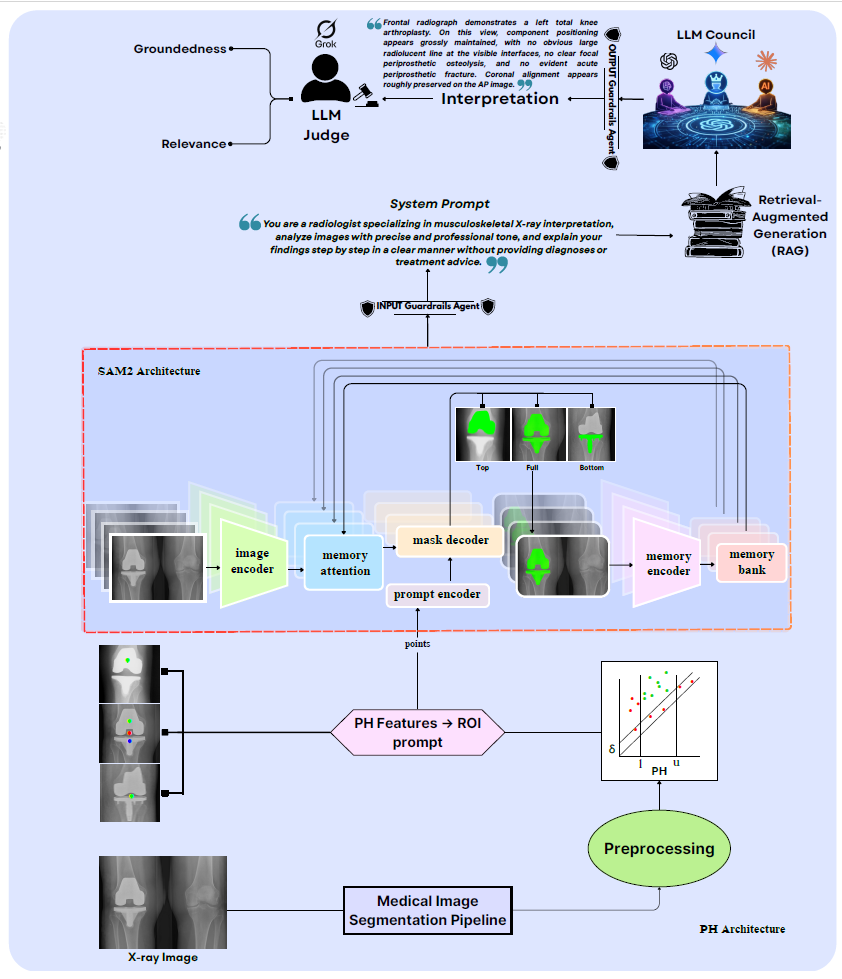

# AI_PH-SAM2: AI-Based Medical Image Segmentation and Interpretation

  

AI-PH-SAM2 uses persistent homology and [SAM2](https://github.com/facebookresearch/sam2) for fully automatic, zero-shot segmentation of knee implants in X-rays, plus rail-guarded LLM interpretation with ChatGPT, Gemini, Claude, and Grok-as-Judge. Tested on 200 radiographs, SAM2-Large performed best.

## Project Sponsor
This project is sponsored by **NSF DART:** Data Analytics that are Robust and Trusted [DART](https://dartproject.org/)
**Award No. OIA-1946391**

## Project Description
PH-SAM2-AI-Medical-Images-Segmentation-Interpretation is a framework for automated medical image segmentation and interpretation of knee implant X-ray radiographs. It combines persistent homology with [SAM2](https://github.com/facebookresearch/sam2) for fully automatic, zero-shot segmentation without fine-tuning. Topology-based centroids are used to guide SAM2 prompts, and the AI interpretation pipeline supports analysis of segmented implant regions for improved medical image understanding.

## LLM Council
AI_PH-SAM2 includes a Retrieval-Augmented Generation (RAG) LLM Council for orthopedic X-ray interpretation. The council consists of:

* GPT-5.2
* Gemini 2.5 Pro
* Claude Sonnet 4

Each model independently analyzes the segmented image using the same retrieved orthopedic reference context. Responses are then evaluated by **Grok 4.3**, which acts as a judge and scores outputs based on **groundedness** and **relevance**. The council architecture was inspired by Andrej Karpathy's discussions on model ensembles and AI councils.

## Contributors
- **Malak Bachri** — GitHub: `Malak Bachri`
- **Qusai Gazawy** — GitHub: `Qusai-Gazawy`

## Repository Information
This repository contains the code, notebooks, models, and documentation for the PH-SAM2 AI medical image segmentation and interpretation pipeline.

## Acknowledgment
This work was supported by **NSF DART (Award No. OIA-1946391)**.
The council architecture was inspired by Andrej Karpathy's LLM Council framework: https://github.com/karpathy/llm-council
